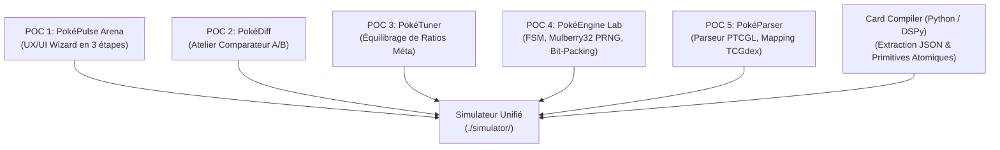
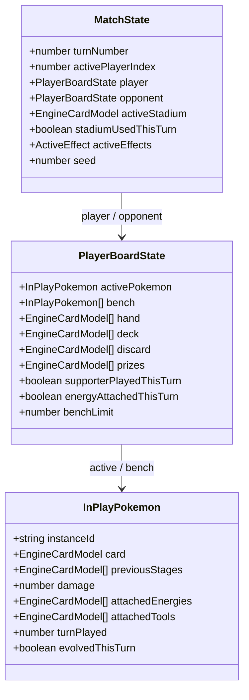
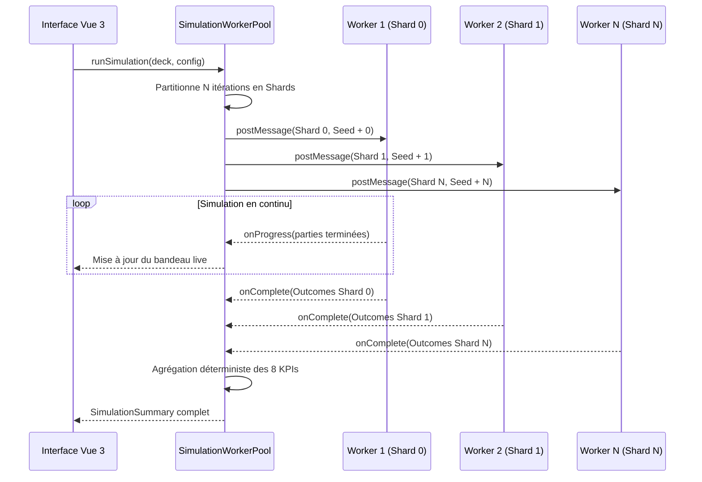

# Architecture et Évolution du Simulateur Pokémon TCG

Ce document constitue la référence technique intégrale pour toute intelligence artificielle ou développeur abordant ce projet sans contexte préalable. Il décrit la genèse, l'architecture logicielle, le modèle de données, les algorithmes de décision et l'état de l'art du simulateur situé dans [`./simulator/`](file:///Users/emmanuelmoulin/.gemini/antigravity/worktrees/POC/build_pokemon_tcg_simulator/simulator/).

---

## 1. Vision et Objectifs du Projet

Le projet a pour but de fournir un banc d'essai décisionnel, déterministe et haute performance pour les joueurs compétitifs du jeu de cartes Pokémon (Pokémon TCG).

### Problème résolu
Dans le circuit compétitif, la majorité des joueurs ajustent 1 à 3 cartes dans leur deck de 60 cartes à la veille d'un tournoi (ex: remplacer un Supporter de pioche par un Objet de recherche, ou modifier le ratio d'énergies de base). Auparavant, ces décisions reposaient uniquement sur l'intuition ou des tests empiriques lents. 

Ce simulateur apporte :
1. Une **confrontation Monte-Carlo massive** contre les archétypes dominants du métagame.
2. Un **comparateur A/B à graine aléatoire identique** (*Same-Seed*), isolant mathématiquement l'impact de chaque micro-ajustement.
3. Des **métriques compétitives avancées** introuvables sur les simulateurs classiques : continuité d'attaque (*Attacker Streaming* sous K.O. continu), résilience aux cartes de perturbation de main (*Iono*, *Tampon Injuste*), flexibilité des *Ordres du Boss*, et télémétrie d'utilisation carte par carte.
4. Une **vitesse de simulation industrielle** via multi-threading natif (Web Workers) et optimisation mémoire (`FastState`, hashes Zobrist, mutations in-place).

---

## 2. Généalogie et Évolution du Projet (Des POCs au Simulateur Unifié)

Le simulateur actuel est l'aboutissement d'une suite de Proofs of Concept (POC) spécialisés, combinés ensuite avec un compilateur de règles automatisé.



### Détail des composants fondateurs

1. **POC 1 — PokéPulse Arena (`./poc-1-pokepulse/`) :**
   - Mise au point du parcours utilisateur en 3 étapes (*Wizard* linéaire sans jargon mathématique : 1. Mon Deck, 2. Paramètres & Adversaires, 3. Résultats & Diagnostic).
   - Établissement de la charte graphique éditoriale sobre (*Clean Light Mode* : fond `bg-slate-50`, cartes `bg-white`, bordures fines `border-slate-200`, boutons `blue-600`, typographie `Inter` et `font-mono`).

2. **POC 2 — PokéDiff (`./poc-2-pokediff/`) :**
   - Conception du comparateur A/B de micro-ajustements.
   - Protocole d'évaluation sous graine déterministe commune (*Same-Seed*), garantissant que le Deck A et le Deck B rencontrent rigoureusement les mêmes tirages et distributions de cartes.

3. **POC 3 — PokéTuner Engine (`./poc-3-poketuner/`) :**
   - Recommandation automatisée de ratios de ressources (énergies, tuteurs, supporters) selon l'environnement de tournoi attendu.

4. **POC 4 — PokéEngine Lab & Inspector (`./poc-4-pokeengine/`) :**
   - Écriture du générateur pseudo-aléatoire déterministe **Mulberry32** et du mélange sans biais de **Fisher-Yates**.
   - Validation de conformité mathématique par la loi hypergéométrique exacte.
   - Première machine à états finis (FSM) vérifiant les 5 invariants stricts du TCG Pokémon (interdiction de Supporter T1 pour le Joueur 1, mal d'évolution `turnPlayed < currentTurn`, limite de 5 Pokémon sur le Banc, etc.).

5. **POC 5 — PokéParser Studio (`./poc-5-decklist-parser/`) :**
   - Parseur de decklists textuelles au format officiel Pokémon TCG Live (PTCGL).
   - Table de correspondance entre codes de sets PTCGL (`MEG`, `TWM`, `SVI`, `SCR`) et identifiants d'API TCGdex (`sv01`, `sv06`, `me01`).

6. **Card Compiler (`./card-compiler/`) :**
   - Pipeline Python exploitant des modèles de langage avec typage strict Pydantic pour compiler les textes bruts de cartes en règles exécutables normalisées ([`EngineCardModel`](file:///Users/emmanuelmoulin/.gemini/antigravity/worktrees/POC/build_pokemon_tcg_simulator/simulator/src/types/cardModel.ts)).
   - Génération de 12 primitives atomiques d'effets et d'un DSL de filtres pour cibler les cartes.

7. **Le Simulateur Unifié (`./simulator/`) :**
   - Réunion de toutes ces briques au sein d'une application de production Vue 3 + TypeScript + Vite.
   - Remplacement des simulations partielles par un moteur de règles complet tour par tour, un arbre de recherche 3-ply Minimax, un pool de Web Workers et un atelier A/B interactif.

---

## 3. Architecture Logicielle Globale

L'arborescence du simulateur dans [`./simulator/src/`](file:///Users/emmanuelmoulin/.gemini/antigravity/worktrees/POC/build_pokemon_tcg_simulator/simulator/src/) s'organise selon une séparation stricte des responsabilités :

```
simulator/src/
├── types/                     # Interfaces TypeScript et contrats de données
│   ├── cardModel.ts           # Schéma EngineCardModel, filtres et primitives
│   ├── deck.ts                # Structures de decklist et tokens PTCGL
│   └── simulator.ts           # Config de simulation, KPIs, traces de branches
├── data/                      # Base de données et référentiels
│   ├── cards_database.json    # Modèles compilés officiels (854 cartes)
│   ├── cardCatalog.ts         # Résolveur universel, alias d'extensions et garde-fous
│   ├── ptcglSetMapping.ts     # Tables d'alias PTCGL <-> TCGdex (SVI, TWM, MEE, 30C...)
│   └── metaDecks.ts           # 3 decks méta de référence
├── core/                      # Moteur de règles déterministe et IA
│   ├── engine.ts              # Machine à états du match, coups légaux, exécution atomique
│   ├── evaluator.ts           # IA Minimax 3-ply, scoring heuristique, élagage
│   ├── fastState.ts           # Hashes Zobrist/Murmur3, buffer Int32Array, mutations in-place
│   ├── filterDsl.ts           # Évaluateur déterministe de filtres de cartes
│   ├── alternativesFinder.ts  # Moteur de recommandation (Supporters -> Objets)
│   ├── gameLoop.ts            # Exécution d'un match complet et calcul des KPIs
│   └── prng.ts                # Générateur déterministe Mulberry32 & Fisher-Yates
├── worker/                    # Multi-threading Web Worker
│   ├── simulation.worker.ts   # Worker individuel traitant des shards de parties
│   └── workerPool.ts          # Orchestrateur de pool, annulation et agrégation
├── utils/                     # Parseurs et utilitaires
│   ├── ptcglParser.ts         # Parseur strict de decklists PTCGL
│   ├── ptcglExporter.ts       # Exporteur au format PTCGL bilingue
│   └── energy.ts              # Gestion native des 9 types d'Énergies de Base
└── components/                # Interface utilisateur Vue 3
    ├── WizardHeader.vue       # Navigation en 3 étapes
    ├── Step1DeckImport.vue    # Import, audit des synergies et garde-fou bloquant
    ├── Step2SimConfig.vue     # Paramètres de simulation et sélection des adversaires
    ├── Step3DashboardAndComparator.vue # Dashboard live, KPIs, télémétrie et A/B
    └── DebugInspectorPanel.vue # Inspecteur pas à pas de l'arbre Minimax (?debug=true)
```

---

## 4. Modèle de Données : La Spécification `EngineCardModel`

Chaque carte du jeu est représentée par une structure déclarative immuable définie dans [`simulator/src/types/cardModel.ts`](file:///Users/emmanuelmoulin/.gemini/antigravity/worktrees/POC/build_pokemon_tcg_simulator/simulator/src/types/cardModel.ts).

### Structure d'une carte
1. **Identité (`CardIdentity`) :**
   - Identifiant unique : `cardId` (ex: `sv06-130`, `sv04-125`).
   - Noms bilingues (`nameFr`, `nameEn`).
   - Marqueur de régulation (`regulationMark`: `"G"`, `"H"`, `"I"`).
   - Règles spéciales : `isAceSpec` (High-Tech, max 1 par deck), `isAncient`, `isFuture`, `isTechnicalMachine`.
2. **Statistiques Pokémon (`PokemonStats`) :**
   - Points de vie (`hp`), Type élémentaire (`pokemonType`), Stade d'évolution (`stage`: `BASIC`, `STAGE_1`, `STAGE_2`).
   - Nom du Pokémon de base dont il évolue (`evolvesFrom`).
   - Règle spéciale `isRuleBox` (ex: Pokémon-ex donnant 2 Récompenses au K.O.), `isTera` (immunité aux dégâts sur le Banc).
   - Capacité de double attaque (`canAttackTwice`, ex: Fête Battante).
   - Faiblesse (`weaknessType`, `weaknessMultiplier`), Résistance, Coût de Retraite.
3. **Actions Jouables (`PlayableAction`) :**
   - Type d'action : `ATTACH_ENERGY`, `PLAY_TRAINER`, `USE_ABILITY`, `DECLARE_ATTACK`, `RETREAT_POKEMON`, `NORMAL_EVOLVE`.
   - Coûts sous forme de dictionnaire normalisé (`energyCost: { "PSYCHIC": 1, "COLORLESS": 1 }`, `discardCost: { count: 2 }`).
   - Primitives d'effets séquentielles (`effects: EffectPrimitive[]`).
4. **Évaluateur Stratégique (`StrategicEvaluator`) :**
   - Rôle IA (`aiRole`: `ATTACKER`, `DRAW_ENGINE`, `GUSHER`, `DISRUPTION`, `ENERGY_ACCEL`).
   - Score intrinsèque de base (`intrinsicBaseScore`).
   - Priorités de défausse quand la carte est morte (`discardPriorityWhenDead`).

### Les 12 Primitives Atomiques d'Effets
Le moteur exécute les effets des cartes via 12 primitives normalisées :
- `SEARCH_DECK` : Recherche de cartes répondant à un filtre (`targetFilter`) depuis le deck vers la main ou le banc.
- `DRAW_CARDS` : Pioche d'un nombre $N$ de cartes.
- `DISCARD_CARDS` : Défausse de cartes depuis la main ou le plateau.
- `ATTACH_ENERGY` : Accélération d'énergie depuis le deck, la défausse ou la main vers un Pokémon cible.
- `HEAL_DAMAGE` : Retrait de marqueurs de dégâts.
- `SWITCH_POKEMON` : Échange du Pokémon Actif avec un Pokémon du Banc.
- `APPLY_DAMAGE` : Application de dégâts sur l'Actif ou le Banc adverse.
- `DISRUPT_HAND` : Mélange et pioche forcée de la main adverse (style Mashynn / Juge).
- `RECOVER_FROM_DISCARD` : Récupération de cartes de la défausse vers la main ou le deck.
- `DISCARD_STADIUM` : Défausse du Stade en jeu.
- `APPLY_STATUS_CONDITION` : Application d'un état spécial (Sommeil, Paralysie, etc.).
- `ITEM_LOCK` : Blocage de l'utilisation des cartes Objet par l'adversaire au tour suivant.

---

## 5. Règle de Blocage Absolue et Source de Vérité

Pour garantir l'intégrité de la simulation, le simulateur applique une règle stricte :

1. **La seule source de vérité pour les modèles :**
   Le fichier [`simulator/src/data/cards_database.json`](file:///Users/emmanuelmoulin/.gemini/antigravity/worktrees/POC/build_pokemon_tcg_simulator/simulator/src/data/cards_database.json) (854 cartes compilées).
2. **Exception native pour les Énergies de Base :**
   Les 9 types d'énergies de base (Plante, Feu, Eau, Électrique, Psy, Combat, Obscurité, Métal, Fée) n'ont pas besoin d'être présentes dans la base compilée. Le module [`energy.ts`](file:///Users/emmanuelmoulin/.gemini/antigravity/worktrees/POC/build_pokemon_tcg_simulator/simulator/src/utils/energy.ts) les détecte et synthétise automatiquement leur modèle à la volée.
3. **Le Guardrail Pré-Simulation :**
   Si **une seule carte** non-énergie d'une decklist de 60 cartes est introuvable dans `cards_database.json` :
   - Le bouton de lancement de simulation est immédiatement désactivé (`disabled="true"`).
   - Un bandeau d'alerte rouge indique les cartes non résolues.
   - Aucun fallback silencieux n'est autorisé.

---

## 6. Le Moteur de Règles (`engine.ts`)

Le cœur du simulateur [`simulator/src/core/engine.ts`](file:///Users/emmanuelmoulin/.gemini/antigravity/worktrees/POC/build_pokemon_tcg_simulator/simulator/src/core/engine.ts) est une machine à états finis déterministe.

### État d'un match (`MatchState`)


### Déroulement d'un tour
1. **Début de tour (`startTurn`) :**
   - Incrémentation du tour, bascule du joueur actif.
   - Réinitialisation des drapeaux de tour (`supporterPlayedThisTurn = false`, `energyAttachedThisTurn = false`, `evolvedThisTurn = false`).
   - Pioche obligatoire de début de tour. Si le deck est vide, le joueur perd immédiatement par *Deck Out*.
2. **Génération des Coups Légaux (`getLegalActions`) :**
   - Évaluation de chaque carte en main, talent de Pokémon en jeu, et attaques de l'Actif.
   - Application des règles officielles :
     - *Règle du Tour 1 Joueur 1 :* Aucune attaque, aucun Supporter, aucune évolution autorisée.
     - *Mal d'évolution :* Un Pokémon ne peut pas évoluer le tour où il est posé (`turnPlayed < state.turnNumber`).
     - *Quota :* Maximum 1 Supporter et 1 attache d'énergie manuelle par tour.
     - *Limite de Banc :* 5 Pokémon maximum par défaut (étendue à 8 si le Stade *Abîme Zéro* est actif avec un Pokémon Téra/Stellaire).
     - *Item-Lock :* Si l'adversaire a utilisé *Item Lock* au tour précédent (ex: Rozbouton), toutes les actions de type Objet sont bloquées.
3. **Exécution Atomique (`applyAction`) :**
   - Déduction des coûts (défausse de cartes en main, retrait d'énergies).
   - Application séquentielle des primitives d'effets.
   - Déclenchement automatique des talents à l'évolution (`ABILITY_ON_EVOLVE`, ex: *Règne Infernal* de Dracaufeu-ex).
   - Calcul des dégâts avec prise en compte des faiblesses ($\times 2$), résistances ($-30$), et outils attachés (*Amulette Bravoure* $+50$ PV, *Cape Héroïque* $+100$ PV).
   - Vérification des K.O. : défausse du Pokémon K.O., prise des Récompenses (1 Récompense pour un Pokémon standard, 2 pour un Pokémon-ex/V), et promotion d'un nouveau Pokémon Actif depuis le Banc.
4. **Vérification des Conditions de Victoire :**
   - `ALL_PRIZES_TAKEN` : Le joueur a pris ses 6 cartes Récompenses.
   - `NO_POKEMON_IN_PLAY` : L'adversaire n'a plus aucun Pokémon en jeu (Actif K.O. et Banc vide).
   - `DECK_OUT` : Le joueur actif ne peut plus piocher au début de son tour.
   - `MAX_TURNS_REACHED` : Limite de tours atteinte (arbitrage par différentiel de prix).

---

## 7. L'Évaluateur Stratégique 3-Ply (`evaluator.ts`)

Pour choisir le meilleur coup parmi toutes les séquences d'actions possibles d'un tour, le simulateur emploie un algorithme d'arbre de recherche 3-ply Minimax défini dans [`simulator/src/core/evaluator.ts`](file:///Users/emmanuelmoulin/.gemini/antigravity/worktrees/POC/build_pokemon_tcg_simulator/simulator/src/core/evaluator.ts).

### Horizon de Décision à 3 Demi-Tours
L'IA ne se contente pas d'évaluer la fin du tour actuel ; elle anticipe sur 3 demi-tours successifs :
1. **Ply 1 ($T$) :** Séquence de jeu du joueur actif.
2. **Ply 2 ($T_{\text{adv}}$) :** Riposte optimale de l'adversaire au tour suivant.
3. **Ply 3 ($T+1$) :** Situation de relance du joueur actif à son tour suivant.

$$\text{Score}(B) = 0.35 \cdot V(S_T) - 0.30 \cdot V_{\text{adv}}(S_{T_{\text{adv}}}) + 0.35 \cdot V(S_{T+1})$$

### Fonction de Valeur d'État $V(S)$
L'évaluation statique d'un plateau $V(S)$ agrège 7 composantes tactiques pondérées :
1. **Différentiel de Récompenses :** $+300$ points par Récompense prise, $-350$ points par Récompense cédée.
2. **Menace Offensive de l'Actif :** Capacité d'infliger un K.O. immédiat ou d'entamer les PV de l'Actif adverse.
3. **Moteur de Banc & Setup :** Présence de tuteurs et moteurs de pioche (Dispareptil, Favianos-ex, Roucarnage-ex).
4. **Investissement en Énergies :** Nombre et répartition des énergies attachées aux attaquants prêts.
5. **Avantage de Main :** Présence de Supporters clés (*Ordres du Boss*, *Pepper*, *Mashynn*) et absence de cartes mortes.
6. **Contrôle du Stade :** Avantage conféré par le Stade en jeu (*Abîme Zéro*, *Académie de Nuit*).
7. **Pénalité de Vulnérabilité :** Risque que l'Actif actuel subisse un K.O. direct au tour adverse par faiblesse ou PV insuffisants.

### Élagage et Déduplication Canonique
Pour éviter l'explosion combinatoire des séquences d'actions interchangeables (ex: attacher une énergie puis jouer Faiblo Ball vs l'inverse), chaque état intermédiaire est dédoublonné via son empreinte d'état. Le paramètre `maxBranches` (8, 20, 50 ou illimité) borne le nombre de branches explorées par tour.

---

## 8. Optimisation Haute Performance (`fastState.ts`)

Pour franchir le cap des dizaines de milliers de parties simulées en quelques secondes, le simulateur intègre des optimisations bas niveau dans [`simulator/src/core/fastState.ts`](file:///Users/emmanuelmoulin/.gemini/antigravity/worktrees/POC/build_pokemon_tcg_simulator/simulator/src/core/fastState.ts) :

1. **Hashing Numérique 53-bit (Zobrist / Murmur3) :**
   - Élimine toute sérialisation de chaînes de caractères (`JSON.stringify`) pour comparer deux états de plateau.
   - Propriété commutative : l'ordre des Pokémon sur le Banc ou des cartes en main produit un hash numérique identique.
2. **Buffer Mémoire Plat `Int32Array(128)` :**
   - Encodage compact des données numériques du plateau (PV restants, énergies attachées, drapeaux de tour, compteurs de cartes).
3. **Mutations In-Place (`mutateInPlace: true`) :**
   - Durant l'exploration Minimax, l'état est directement muté puis restauré plutôt que cloné en mémoire, réduisant la pression sur le Garbage Collector de JavaScript de plus de 90 %.
   - Permet d'atteindre un débit supérieur à **50 parties 3-ply complètes par seconde par cœur de processeur**.

---

## 9. Parallélisation par Web Workers (`workerPool.ts`)

La simulation s'exécute de manière non-bloquante pour l'interface graphique :



- **Régulation des Threads :** Le nombre de Web Workers s'adapte automatiquement au matériel (`navigator.hardwareConcurrency`, généralement entre 4 et 12 threads).
- **Annulation Immédiate :** L'utilisateur dispose d'un bouton d'arrêt d'urgence qui détruit (`worker.terminate()`) instantanément tous les threads actifs sans figer le navigateur.

---

## 10. Les Métriques Compétitives et Télémétrie Avancée

Le simulateur calcule un ensemble complet de KPIs tactiques :

### Les 8 KPIs Obligatoires
1. **Win Rate Global (%) :** Pourcentage de victoires sur l'ensemble des itérations.
2. **Décomposition par Matchup :** Taux de victoire individuel contre chacun des archétypes adverses sélectionnés.
3. **Récompenses Moyennes Gagnées :** Capacité du deck à clôturer les 6 Récompenses (valeur de 0 à 6).
4. **Récompenses Moyennes Concédées :** Résistance défensive face aux offensives adverses.
5. **Durée Totale et Vitesse :** Temps d'exécution en millisecondes et débit réel en parties/seconde.
6. **Vitesse de Setup (T1/T2) :** Pourcentage de parties où le deck établit son attaquant principal ou son moteur au Tour 1 et Tour 2, avec histogramme détaillé.
7. **Continuité d'Attaque (*Attacker Streaming Rate*) :** Capacité du deck à réenchaîner une attaque puissante à chaque tour, même lorsque son Pokémon Actif subit un K.O. immédiat chaque tour.
8. **Résilience Post-Perturbation (*Post-Disruption Resilience*) :** Taux de reprise et de victoire après avoir subi une carte réduisant la main à 1 ou 2 cartes (*Tampon Injuste*, *Mashynn* en fin de partie).

### Métriques Tactiques Spécifiques
- **Indice de Flexibilité des Ordres du Boss :** Fréquence à laquelle le deck parvient à jouer un Supporter de ciblage (*Ordres du Boss*) pour achever un Pokémon du Banc tout en continuant d'attaquer sans avoir besoin de jouer un Supporter de pioche.
- **Support des Combos à Conditions Strictes :** Statistiques des mécaniques particulières telles que la double attaque (*Fête Battante* de Pomdramour/Poissoroy tant qu'un Stade est actif).
- **Efficacité J2 Tour 1 (*Item-Lock Rozbouton*) :** Mesure de l'impact d'un blocage d'Objets initié dès le premier tour du Joueur 2.
- **Télémétrie par Carte & Alternatives :** Taux de tirage, taux de jeu, et nombre moyen de tours où la carte est restée "morte" en main. Le moteur [`alternativesFinder.ts`](file:///Users/emmanuelmoulin/.gemini/antigravity/worktrees/POC/build_pokemon_tcg_simulator/simulator/src/core/alternativesFinder.ts) détecte automatiquement les cartes sous-utilisées et suggère des alternatives de substitution (ex: remplacer un Supporter en excès par un Objet équivalent).

---

## 11. Les 3 Decks Méta de Référence Actuels

Le simulateur intègre les 3 decks majeurs du métagame compétitif dans [`simulator/src/data/metaDecks.ts`](file:///Users/emmanuelmoulin/.gemini/antigravity/worktrees/POC/build_pokemon_tcg_simulator/simulator/src/data/metaDecks.ts) :

| Nom du Deck | Identifiant | Archétype & Rôle | Mécanique Clé |
| :--- | :--- | :--- | :--- |
| **Lanssorien-ex** | `meta_lanssorien_ex` | `Spread & Contrôle` | Moteur Dispareptil, attaque *Plongée Fantôme* (200 Actif + 60 répartis sur le Banc), manipulation de marqueurs avec Munkidori et Item-Lock via Rozbouton. |
| **Méga-Kangourex-ex** | `meta_mega_kangourex_ex` | `Accélération & Multi-Attaquants` | Stade *Abîme Zéro* étendant le banc à 8 places, transferts d'énergies multiples avec Échange d'Énergie et Crispin, association avec Ogerpon-ex et Koraidon-ex. |
| **Roigada** | `meta_roigada` | `Combo & Manipulation de Deck` | Ordonnancement du dessus du deck via *Décodage du Cryptologue* et *Académie de Nuit*, attaque puissante de Roigada, soutien de Métalosse et Kyurem. |

---

## 12. Commandes de Validation et Cycle de Vie

### Synchronisation des Cartes
Avant chaque test ou compilation, un script synchronise la base de données de cartes :
```bash
# Dans le dossier ./simulator/
npm run sync-cards
# Vérifie, réintègre et normalise les cartes de référence dans simulator/src/data/cards_database.json
```

### Exécution des Tests Automatisés
Tous les aspects critiques du moteur sont couverts par Vitest :
```bash
npm test
```
Les 6 suites de tests valident :
- `src/utils/ptcglParser.test.ts` : Résolution des cartes, respect des 60 cartes, détection des ACE SPECs, validité du format Standard.
- `src/core/engine.test.ts` : Déroulement complet d'un match, respect des 5 invariants légaux, résolution des talents à l'évolution (*Règne Infernal*).
- `src/core/evaluator.test.ts` : Anticipation Minimax 3-ply, pondération des menaces et élagage.
- `src/core/fastState.test.ts` : Invariance du hash Zobrist, encodage mémoire `Int32Array`, mutations in-place et débit > 30 parties/s sur decks complexes.
- `src/core/gameLoop.test.ts` : Déterminisme strict à graine fixe, complétion des 8 KPIs obligatoires, résilience aux K.O.
- `src/core/alternativesFinder.test.ts` : Détection des cartes mortes et pertinence des suggestions de remplacement.

### Compilation et Build de Production
```bash
npm run build
# Exécute vue-tsc (vérification de typage TypeScript strict) puis vite build
```

---

## 13. Directives et Règles Absolues pour les Évolutions Futures

Toute modification ultérieure du code doit obligatoirement respecter les règles suivantes :

1. **Zéro Émojis :** Aucun caractère émoji ne doit être inséré dans le code source, l'interface graphique, les commentaires ou les commits. Utiliser des balises textuelles claires ou des icônes SVG si nécessaire.
2. **Garde-Fou des Cartes :** Ne jamais réintroduire de modèles de secours fictifs (*fallbacks*) pour les Pokémon et Dresseurs. Une carte non résolue doit impérativement bloquer le lancement de la simulation.
3. **Respect du Déterminisme :** Toute nouvelle règle de jeu ou évaluation de talent doit être strictement déterministe sous une graine PRNG donnée. L'aléa physique doit passer exclusivement par le PRNG Mulberry32 du match.
4. **Non-Régression de Performance :** Les ajouts dans la boucle de jeu ne doivent pas dégrader le débit sous la barre des 30 parties 3-ply complètes par seconde par thread. Préférer les structures typées, les identifiants numériques et les mutations in-place aux clonages profonds d'objets.
