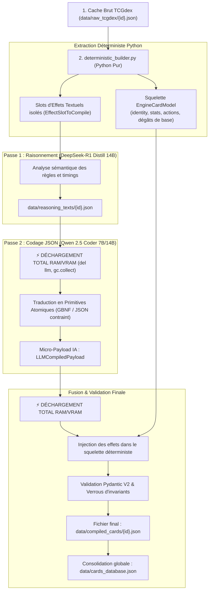

# Le Compilateur de Cartes Pokémon TCG (`card-compiler`)
## Architecture Hybride Déterministe / IA, Modélisation Formelle et Pipeline en Deux Passes
*Document technique de référence — Conception, Évolution et Spécifications du Système*

---

## 1. Résumé Exécutif & Vision Globale

Le projet **Pokémon TCG Card Compiler** est un compilateur statique et sémantique conçu pour transformer le corpus de cartes du Jeu de Cartes à Collectionner Pokémon (**Pokémon TCG — Format Standard officiel**) en un modèle formel exécutable par un moteur de simulation numérique, un algorithme d'arbre de recherche Monte Carlo (**MCTS**) et des agents heuristiques.

Contrairement aux jeux de stratégie abstraits comme les Échecs ou le Go où les règles sont fixes et immuables, un jeu de cartes à collectionner applique le principe des **règles dynamiques décentralisées** : chaque carte introduit son propre texte de règles qui modifie, surcharge ou suspend les règles fondamentales du jeu.

Le défi fondamental de ce projet est de **traduire fidèlement le langage naturel des cartes en un Arbre de Syntaxe Abstraite (AST) normalisé et typé**, sans hallucination, avec une garantie de 100 % de validité syntaxique et structurelle, tout en opérant sur du matériel grand public (**Apple Silicon Unified Memory**).

---

## 2. Problématique Métier : Du Langage Naturel aux Primitives Moteur

Les données sources proviennent de l'API officielle **TCGdex** (en français et anglais). Ces données brutes présentent des limitations majeures pour un moteur de jeu :
1. **Ambiguïtés textuelles** : Une attaque décrivant *"Défaussez 2 Énergies de ce Pokémon pour infliger 120 dégâts au Banc adverse"* combine plusieurs concepts (coût d'effet, zone source, zone cible, calcul de dégâts, restriction de cible).
2. **Conditions temporelles et contextuelles** : Certaines cartes ne sont jouables qu'au Tour 1 en second, d'autres exigent qu'un Pokémon précis soit sur le Banc ou qu'un K.O. ait eu lieu au tour précédent.
3. **Cartes mortes en main (*Dead Cards*)** : Pour un algorithme de recherche MCTS ou une heuristique d'élagage, savoir immédiatement si une carte est totalement injouable dans l'état de jeu courant sans devoir simuler toutes ses branches est une optimisation critique.

L'objectif du compilateur est de générer pour chaque carte un modèle final validé : **`EngineCardModel`**.

---

## 3. Historique & Évolution Architecturale : De la V1 à la V3

Le compilateur a traversé trois grandes phases architecturales, guidées par les retours d'expérience sur la précision des modèles de langage et les contraintes physiques de mémoire.

```
┌─────────────────────────────────┐
│  Génération 1 : Monolithique    │ ──► Hallucinations sur les stats,
│  (Single-Pass LLM direct)       │     gaspillage de tokens, saturation RAM.
└─────────────────────────────────┘
                 │
                 ▼
┌─────────────────────────────────┐
│  Génération 2 : Découplée       │ ──► Raisonnement profond séparé du code,
│  (Two-Pass : DeepSeek -> Qwen)  │     vidage mémoire intermédiaire strict.
└─────────────────────────────────┘
                 │
                 ▼
┌─────────────────────────────────┐
│  Génération 3 : Hybride Ciblée  │ ──► Règle : "Ne demander à l'IA que ce qu'on
│  (Python Déterministe + Micro)  │     ne connaît pas". 0 hallucination sur 80%
└─────────────────────────────────┘     des champs.
```

---

### Génération 1 (V1) : L'Approche Monolithique "Single-Pass"
* **Concept** : Un prompt massif alimentait un LLM généraliste (Qwen 2.5 Coder 14B ou 32B) avec le JSON brut TCGdex, et lui demandait de générer directement l'intégralité du JSON `EngineCardModel`.
* **Problèmes rencontrés** :
  1. *Hallucinations sur l'évident* : Le LLM inventait parfois les PV, se trompait sur le coût de retraite ou altérait le nom de l'extension, alors que ces données étaient déjà présentes dans le JSON source.
  2. *Gaspillage massif de bande passante/tokens* : Demander à l'IA d'écrire des dizaines de lignes de métadonnées statiques ralentissait le débit global.
  3. *Charge cognitive mixte* : L'IA devait simultanément comprendre les subtilités de règles complexes et respecter une syntaxe JSON volumineuse sans erreur de parenthèses.
  4. *Goulot mémoire matériel* : Charger un modèle 32B monopolisait ~20 Go de RAM unifiée, figeant la machine de travail de l'utilisateur.

---

### Génération 2 (V2) : Le Pipeline en Deux Passes Découplées (*Two-Pass Pipeline*)
* **Concept** : Séparer l'effort en deux étapes distinctes avec **déchargement mémoire strict** :
  * **Passe 1 (Raisonnement approfondi)** : Le modèle de réflexion **DeepSeek-R1 Distill Qwen 14B** analyse le texte des règles, explicite la logique du tour, identifie les pièges et génère une analyse textuelle sauvegardée dans `data/reasoning_texts/{id}.json`.
  * **Déchargement strict** : L'IA 1 est détruite et la mémoire unifiée est purgée (`del llm ; gc.collect()`).
  * **Passe 2 (Codage JSON formel)** : Le modèle de programmation **Qwen 2.5 Coder** lit l'analyse textuelle de la Passe 1 et la transforme en JSON formel sous contrainte syntaxique (GBNF / Constrained Decoding).
* **Bénéfice** : Élimination de la surcharge cognitive. Deux modèles spécialisés se succèdent sans jamais résider en mémoire simultanément.
* **Modes d'intensité introduits** :
  * Mode `soft` (~7-8 Go RAM) : DeepSeek-R1 14B 4-bit puis Qwen 2.5 Coder 7B 8-bit. Conçu pour tourner en journée sans impacter le travail de l'utilisateur.
  * Mode `intense` (~14-18 Go RAM) : DeepSeek-R1 14B 8-bit puis Qwen 2.5 Coder 14B 8-bit. Conçu pour les sessions de nuit ou dédiées.

---

### Génération 3 (V3 - Architecture Actuelle) : L'Approche Hybride Déterministe
* **Principe directeur** : **« Ne demander à l'IA que ce qu'on ne connaît pas. »**
* **Constat** : En lisant `data/raw_tcgdex/{id}.json`, Python connaît déjà de manière certaine **80 % de la structure de la carte** (identité, type, PV, stade d'évolution, coûts d'attaque, dégâts bruts, faiblesses, retraites).
* **Implémentation (`deterministic_builder.py`)** :
  * Python assemble 100 % du squelette déterministe (`DeterministicCardSkeleton`).
  * Python isole uniquement les textes d'effets non résolus dans une liste de slots d'effets (`EffectSlotToCompile`).
  * L'IA de Passe 1 analyse uniquement ces slots.
  * L'IA de Passe 2 ne produit plus la carte entière, mais un micro-JSON ultra-compact : **`LLMCompiledPayload`**.
  * Python réinjecte les primitives traduites dans le squelette et applique des verrous d'invariants stricts.
* **Résultat** : Débit multiplié par 3, suppression totale des hallucinations sur les statistiques, et robustesse absolue.

---

## 4. Fonctionnement Détaillé du Pipeline Hybride Actuel



---

### Étape 1 : Construction Déterministe (`compiler/deterministic_builder.py`)
Python résout sans aucune IA :
* **Identité (`CardIdentity`)** :
  * Calcul exact des cartes Récompense (`prizeCardsGiven`) : 3 pour les Méga-Pokémon-ex / VMAX, 2 pour les Pokémon-ex / V / VSTAR, 1 pour les Pokémon réguliers.
  * Détection de `isRuleBox` (si `prizeCardsGiven >= 2` ou Radieux).
  * Détection déterministe des flags `isAceSpec`, `isAncient`, `isFuture`, `isTera`.
* **Statistiques (`PokemonStats`)** :
  * PV (`hp`), types, coût de retraite (`retreatCost`), faiblesses et résistances.
  * Résolution de la lignée généalogique complète (`evolvesFrom`, `rootBasicName`, `evolutionChain`) par traversée de l'index TCGdex.
* **Squelettes d'Actions (`PlayableAction`)** :
  * Création des actions statiques : `PLAY_FROM_HAND`, `EVOLVE`, `RETREAT`, `ATTACH_ENERGY`.
  * Pour chaque attaque : nom, coût en énergies agrégé (`cost: {"Feu": 2, "Incolore": 1}`), timings de tour (`canUseTurn1GoingFirst: false`, `canUseTurn1GoingSecond: true`).
  * Extraction regex des dégâts purs : si l'attaque indique `"120"` sans condition, l'effet atomique `DAMAGE_ACTIVE(value=120)` est pré-injecté directement par Python.
* **Court-circuit des Énergies de Base** :
  * Traitement instantané (0 token, 0.00s) sans appel aux LLM.

---

### Étape 2 : Passe 1 — Raisonnement Sémantique (`compiler/reasoning_engine.py`)
* **Modèle** : `DeepSeek-R1-Distill-Qwen-14B` (version 4-bit en mode `soft`, 8-bit en mode `intense`).
* **Backend** : Apple Silicon Native MLX ou Metal llama.cpp.
* **Rôle** : L'IA reçoit uniquement les textes d'effets des slots non triviaux. Elle produit une réflexion en chaîne de pensée (*Chain of Thought*) structurée :
  1. Nature de l'effet et moment d'activation.
  2. Préconditions strictes requises sur l'état de jeu.
  3. Décomposition chronologique des effets atomiques (coût -> recherche -> mélange).
  4. Identification des conditions rendant la carte complètement morte en main.
  5. Profil stratégique de la carte et poids d'utilité selon les tours.
* **Sortie** : Fichier JSON complet de métadonnées et texte de raisonnement dans `data/reasoning_texts/{card_id}.json`.
* **Libération mémoire** : Destruction de l'instance du modèle, suppression du graphe de calcul, appel à `gc.collect()`. La mémoire unifiée redevient 100 % disponible.

---

### Étape 3 : Passe 2 — Codage Micro-Ciblé (`compiler/two_pass_pipeline.py`)
* **Modèle** : `Qwen2.5-Coder-7B-Instruct` (mode `soft`) ou `14B` (mode `intense`).
* **Rôle** : L'IA lit l'analyse textuelle de la Passe 1 et émet sous décodage contraint **uniquement** le schéma `LLMCompiledPayload` :
  ```python
  class LLMCompiledPayload(BaseModel):
      translatedSlots: List[LLMTranslatedSlot]  # Effets atomiques ordonnés par slotId
      aiRole: AIRole                            # Rôle stratégique
      turnPhaseWeights: TurnPhaseWeights        # Pondérations Tour 1, 2, 3, 4+ (0.0 à 1.0)
      additionalSynergyTags: List[str]          # Tags de synergie (ex: requires_stage_2)
  ```
* **Décodage Contraint** : Le LLM ne peut physiquement pas émettre de clés superflues ou invalides.

---

### Étape 4 : Fusion, Verrous d'Invariants & Validation Finale
Python prend le micro-payload de l'IA et le fusionne avec le squelette déterministe :
1. Chaque `LLMTranslatedSlot` est réinjecté dans son action correspondante (`ability_0`, `attack_0`, `trainer_0`).
2. Si une attaque contenait déjà des dégâts déterministes, Python s'assure qu'ils sont préservés et enrichit les effets secondaires.
3. Les tags de synergie IA sont fusionnés avec les synergies déterministes d'évolution et d'énergie.
4. Validation Pydantic V2 intégrale du document `EngineCardModel`.
5. Sauvegarde atomique dans `data/compiled_cards/{card_id}.json` et synchronisation incrémentale dans la base consolidée `data/cards_database.json`.

---

## 5. Spécification Complète du Modèle de Données

### A. Énumérations Normalisées (MAJUSCULES AVEC UNDERSCORES)

| Énumération | Valeurs Possibles | Rôle |
| :--- | :--- | :--- |
| **`CardCategory`** | `POKEMON`, `TRAINER`, `ENERGY` | Catégorie maîtresse de la carte. |
| **`CardSubCategory`** | `BASIC`, `STAGE_1`, `STAGE_2`, `SUPPORTER`, `ITEM`, `STADIUM`, `TOOL`, `BASIC_ENERGY`, `SPECIAL_ENERGY` | Sous-catégorie régissant les règles d'usage. |
| **`ActionType`** | `PLAY_FROM_HAND`, `EVOLVE`, `USE_ABILITY`, `ATTACH_ENERGY`, `RETREAT`, `ATTACK` | Type mécanique de l'action pour le moteur. |
| **`TimingPhase`** | `PREPARATION`, `MAIN_PHASE_1`, `MAIN_PHASE_2`, `ATTACK_PHASE` | Phase de jeu où l'action peut être déclenchée. |
| **`EffectPrimitive`** | `SEARCH_DECK`, `DRAW_CARDS`, `DAMAGE_ACTIVE`, `DAMAGE_BENCH`, `ATTACH_ENERGY`, `DISCARD_CARDS`, `HEAL`, `SWITCH_ACTIVE`, `APPLY_SPECIAL_CONDITION`, `EVOLVE_POKEMON`, `SHUFFLE_HAND_DRAW`, `RECOVER_FROM_DISCARD` | Primitives atomiques composant l'arbre d'exécution du moteur. |
| **`AIRole`** | `MAIN_ATTACKER`, `SECONDARY_ATTACKER`, `DRAW_ENGINE`, `ENERGY_ACCELERATOR`, `GUEST_TECH`, `DISRUPTION`, `CONSISTENCY_BOOSTER` | Rôle heuristique principal pour les algorithmes d'IA. |

---

### B. Primitives Atomiques d'Effets (`AtomicEffect`)

Chaque pouvoir, attaque ou carte Dresseur est décomposé en une liste d'effets élémentaires :
```python
class AtomicEffect(BaseModel):
    primitive: EffectPrimitive    # Primitive d'action normalisée
    target: Optional[str]         # "SELF", "OPPONENT_ACTIVE", "OPPONENT_BENCH", "OWN_BENCH", "PLAYER"
    value: Optional[int]          # Dégâts infligés, points de vie soignés, etc.
    count: Optional[int]          # Nombre de cartes à piocher, chercher ou défausser
    zone: Optional[str]           # "DECK", "HAND", "DISCARD", "BENCH", "ACTIVE"
    filter: Optional[str]         # Format DSL : "CATEGORY:POKEMON|STAGE:BASIC|MAX_HP:70"
    upTo: bool = False            # True si le texte indique "jusqu'à X"
    optional: bool = False        # True si l'effet est facultatif ("vous pouvez")
```

---

### C. Structure Globale de la Carte Compilée (`EngineCardModel`)

```python
class EngineCardModel(BaseModel):
    cardId: str                                   # ID officiel TCGdex (ex: "sv03-125")
    identity: CardIdentity                        # Identité complète, rareté, légalités
    pokemonStats: Optional[PokemonStats]          # PV, types, lignée (null si Dresseur/Énergie)
    category: CardCategory                        # POKEMON, TRAINER, ENERGY
    subCategory: CardSubCategory                  # STAGE_2, ITEM, SUPPORTER, etc.
    playableActions: List[PlayableAction]         # Séquence de toutes les actions jouables
    strategicEvaluator: StrategicEvaluator        # Évaluation heuristique, poids temporels, synergies
    compilationMetadata: Optional[CompilationMetadata] # Télémétrie, vitesse d'inférence (t/s)
```

---

## 6. Architecture Matérielle & Matrice Officielle des Modèles

Le compilateur optimise l'exécution sur architecture **Apple Silicon (séries M1, M2, M3, M4)** grâce à la mémoire unifiée et au support natif **Apple MLX** (`mlx-lm`) et **Metal GGUF** (`llama.cpp`) :

| Palier | Phase | Modèle MLX Natif (Safetensors) | Modèle GGUF Metal (llama.cpp) | RAM Utilisée | Profil d'Usage |
| :--- | :--- | :--- | :--- | :--- | :--- |
| **`soft`** | **Passe 1 (Raisonnement)** | `DeepSeek-R1-Distill-Qwen-14B-4bit` | `DeepSeek-R1-Distill-Qwen-14B-GGUF (Q4_K_M)` | **~7-8 Go** | Travail de jour, IDE/navigateur ouverts en parallèle. |
| **`soft`** | **Passe 2 (Codage JSON)** | `Qwen2.5-Coder-7B-Instruct-8bit` | `Qwen2.5-Coder-7B-Instruct-GGUF (Q8_0)` | **~7-8 Go** | Vitesse maximale de génération JSON formel. |
| **`intense`**| **Passe 1 (Raisonnement)** | `DeepSeek-R1-Distill-Qwen-14B-8bit` | `DeepSeek-R1-Distill-Qwen-14B-GGUF (Q8_0)` | **~14-16 Go** | Sessions dédiées, mode nuit (AFK), précision extrême. |
| **`intense`**| **Passe 2 (Codage JSON)** | `Qwen2.5-Coder-14B-Instruct-8bit` | `Qwen2.5-Coder-14B-Instruct-GGUF (Q8_0)` | **~14-16 Go** | Granularité maximale sur cartes très complexes. |

---

## 7. Boîte à Outils CLI & Fonctionnalités de Production

L'interface en ligne de commande (bâtie avec **Typer** et **Rich**) offre un environnement complet de pilotage du corpus :

1. **Double passe séquencée ou unifiée** :
   * `python -m compiler.cli reason` : Génère toutes les analyses textuelles (Passe 1).
   * `python -m compiler.cli code` : Transforme les analyses en code JSON (Passe 2).
   * `python -m compiler.cli run --pipeline two_pass --phase all` : Enchaîne les 2 étapes automatiquement avec déchargement mémoire garanti.
2. **Réexécution ciblée (`re-run`)** :
   * `python -m compiler.cli re-run --phase reason` : Inspecte `data/reasoning_texts/` et rejoue la Passe 1.
   * `python -m compiler.cli re-run --phase code` : Inspecte `data/compiled_cards/` et rejoue la Passe 2.
   * `python -m compiler.cli re-run --phase all` : Rejoue les deux passes sur les cartes existantes.
   * *Résilience* : Si un ID demandé via `-f data/target_ids.txt` n'existe pas sur le disque, il est automatiquement téléchargé depuis TCGdex. Si la Passe 2 est demandée sur une carte sans analyse préalable, la Passe 1 est générée à la volée.
3. **Pilotage & Métriques** :
   * `remaining` : Compte le nombre exact de cartes restant à traiter (globalement, par set via `--set`, ou filtré avec `--reasoned`).
   * `count` : Affiche l'inventaire des cartes compilées ou raisonnées sur le disque.
   * `sync` : Synchronise le fichier global `data/cards_database.json`.
   * `stats` : Valide 100 % de la conformité Pydantic V2 de tous les fichiers du corpus.
   * `fetch-cards --raw` : Met en cache les données brutes TCGdex de toutes les cartes du format Standard légal (~3 500 cartes).

---

## 8. Fiabilité & Tests Automatisés

Le compilateur intègre une suite de **127 tests unitaires automatisés** exécutés via `unittest` validant :
* La résolution déterministe de 100 % des statistiques Pokémon et identités.
* L'isolation stricte de la mémoire entre les passes du pipeline.
* La tolérance aux variations LLM (*auto-healing*) lors de la lecture des sorties IA.
* La déduplication automatique des listes d'entrées d'identifiants de cartes.
* La validité Pydantic V2 de toutes les cartes compilées de référence.

---

## 9. Conclusion

Le compilateur de cartes Pokémon TCG démontre qu'une architecture d'IA appliquée ne doit pas s'appuyer aveuglément sur un modèle de langage pour l'intégralité d'un problème. 

En déléguant **80 % de la structure connue au déterminisme du code Python** et en réservant **le pipeline LLM en deux passes exclusivement à l'interprétation sémantique du texte de règle**, le compilateur atteint un niveau de fiabilité industrielle : zéro hallucination sur les métadonnées, respect strict de la syntaxe du moteur de jeu, et exécution fluide sur des stations de travail bureautiques sans infrastructure serveur dédiée.
