# Pokémon TCG Card Compiler (`card-compiler`)

Compilateur et extracteur IA haute performance pour le Jeu de Cartes à Collectionner Pokémon (**Pokémon TCG - Format Standard**).

Il interroge l'API officielle **TCGdex**, charge des modèles d'IA locaux sur **Apple Silicon** (via **Apple MLX** natif ou **Metal llama.cpp** GBNF) ou se connecte à un serveur **LM Studio** distant. Il traduit chaque carte en un modèle formel déterministe, typé et validé par Pydantic V2 (`EngineCardModel`), prêt pour un moteur de simulation numérique.

---

## 🌟 Points Forts & Architecture

- **2 Modes de Travail au Choix** :
  - **Mode 1 (Single-Pass / Direct)** : L'IA produit directement le JSON formel à partir des données de la carte.
  - **Mode 2 (Two-Pass Découplé)** : Une IA de raisonnement approfondi (DeepSeek-R1) analyse d'abord les règles et génère un rapport textuel complet. Puis, l'IA 1 est **déchargée à 100 % de la mémoire**, et une IA de programmation (Qwen Coder) transforme ces analyses en JSON formel sans jamais saturer la RAM.
- **2 Paliers d'Intensité (`soft` et `intense`)** :
  - **`soft` (Par défaut, ~7-8 Go RAM)** : Conçu pour tourner confortablement en journée pendant que votre navigateur, IDE et autres applications sont ouverts.
  - **`intense` (~14-18 Go RAM)** : Conçu pour les sessions dédiées ou le mode nuit (AFK) avec les applications fermées.
- **Inférence Locale Apple Silicon Ultra-Rapide** :
  - **Apple MLX (`LOCAL_BACKEND=mlx`)** : Chargement direct en mémoire unifiée via `mlx-lm` avec streaming en temps réel (tokens/sec effectifs).
  - **Apple Metal GGUF (`LOCAL_BACKEND=llama_cpp`)** : Exécution locale Metal avec décodage contraint GBNF.
- **Support LM Studio** : Connexion REST directe (locale ou distante sur réseau local / VPN) avec parallélisation multi-slots.
- **Court-circuit Déterministe des Énergies de Base** : Compilation instantanée (0 token, 0.00s).
- **Reprise sur Cache Intelligente** : Les cartes et analyses déjà calculées ne sont jamais recalculées inutilement.

---

## 🔄 Comparatif des Modes de Travail

```mermaid
flowchart TD
    subgraph Mode1["Mode 1 : Inférence Directe (Single-Pass)"]
        A1["Données TCGdex"] --> B1["IA Générale (Qwen 2.5 Coder 14B/32B)"]
        B1 --> C1["Validation Pydantic V2"]
        C1 --> D1["JSON Formel (data/compiled_cards/)"]
    end

    subgraph Mode2["Mode 2 : Pipeline en 2 Étapes Découplées (Two-Pass)"]
        A2["Données TCGdex"] --> B2["Passe 1 : IA Raisonnement (DeepSeek-R1 Distill 14B)"]
        B2 --> C2["Analyses de Règles (data/reasoning_texts/)"]
        C2 --> D2["⚡ Déchargement strict de l'IA 1 (Libération RAM)"]
        D2 --> E2["Passe 2 : IA Coding (Qwen 2.5 Coder 7B/14B)"]
        E2 --> F2["Validation Pydantic V2"]
        F2 --> G2["JSON Formel (data/compiled_cards/)"]
    end
```



---

## 🎯 Matrice Officielle des Modèles

Le compilateur résout automatiquement le bon modèle selon vos choix de **Mode**, d'**Intensité** et de **Backend** :

| Mode | Étape / Phase | Intensité `soft` (Défaut - ~7-8 Go RAM) | Intensité `intense` (Mode AFK/Nuit - ~14-18 Go RAM) | Backend |
| :--- | :--- | :--- | :--- | :--- |
| **Mode 1** *(Direct)* | Passe Unique | `mlx-community/Qwen2.5-Coder-14B-Instruct-4bit` | `mlx-community/Qwen2.5-Coder-32B-Instruct-4bit` | **MLX** |
| **Mode 1** *(Direct)* | Passe Unique | `bartowski/Qwen2.5-Coder-14B-Instruct-GGUF` | `bartowski/Qwen2.5-Coder-32B-Instruct-GGUF` | **GGUF** |
| **Mode 2** *(Two-Pass)* | **Passe 1 : Raisonnement** | `mlx-community/DeepSeek-R1-Distill-Qwen-14B-4bit` | `mlx-community/DeepSeek-R1-Distill-Qwen-14B-8bit` | **MLX** |
| **Mode 2** *(Two-Pass)* | **Passe 1 : Raisonnement** | `bartowski/DeepSeek-R1-Distill-Qwen-14B-GGUF` *(Q4_K_M)* | `bartowski/DeepSeek-R1-Distill-Qwen-14B-GGUF` *(Q8_0)* | **GGUF** |
| **Mode 2** *(Two-Pass)* | **Passe 2 : Codage JSON** | `mlx-community/Qwen2.5-Coder-7B-Instruct-8bit` | `mlx-community/Qwen2.5-Coder-14B-Instruct-8bit` | **MLX** |
| **Mode 2** *(Two-Pass)* | **Passe 2 : Codage JSON** | `bartowski/Qwen2.5-Coder-7B-Instruct-GGUF` | `bartowski/Qwen2.5-Coder-14B-Instruct-GGUF` | **GGUF** |

> [!TIP]
> Tous les modèles en intensité **`soft`** consomment moins de **8 Go de mémoire unifiée**, garantissant une fluidité totale même sur un Mac avec 24 Go de RAM ayant déjà 16-17 Go utilisés par vos logiciels de travail.

---

## 📂 Structure du Répertoire

```text
card-compiler/
├── run_reasoning.py         # Script direct : Lance la Passe 1 (Raisonnement)
├── run_coding.py            # Script direct : Lance la Passe 2 (Codage JSON)
├── setup_mac_metal.sh       # Script d'installation automatique Metal & dépendances
├── requirements.txt         # Dépendances Python (mlx, llama-cpp-python, pydantic, typer, rich)
├── .env                     # Configuration active (modèle, mode, backend, intensité)
├── .env.example             # Modèle de configuration commenté
├── README.md                # Documentation complète
│
├── data/
│   ├── raw_tcgdex/          # Cache JSON brut des cartes téléchargées depuis TCGdex
│   ├── reasoning_texts/     # Analyses de règles générées en Passe 1 ({card_id}.json)
│   ├── compiled_cards/      # Modèles formels finaux compilés ({card_id}.json)
│   └── cards_database.json  # Base de données consolidée de toutes les cartes du jeu
│
├── compiler/
│   ├── models_config.py     # Matrice des modèles (soft/intense, single/two-pass, mlx/gguf)
│   ├── reasoning_engine.py  # Moteur de raisonnement expert PTCG (Passe 1)
│   ├── two_pass_pipeline.py # Orchestrateur Two-Pass avec libération stricte de mémoire
│   ├── mlx_engine.py        # Moteur Apple MLX natif safetensors
│   ├── llm_engine.py        # Moteur Apple Metal llama.cpp GGUF & prompts PTCG
│   ├── lm_studio_compiler.py# Moteur client LM Studio (REST direct local ou distant)
│   ├── schemas.py           # Schémas stricts Pydantic V2 & normalisation d'enums
│   ├── post_processor.py    # Enrichissement et règles d'invariants Pokémon TCG
│   ├── static_cards.py      # Court-circuit déterministe pour Énergies de Base
│   ├── tcgdex_fetcher.py    # Client TCGdex (SDK officiel ou REST httpx)
│   └── cli.py               # Interface CLI Typer unifiée
│
└── tests/                   # Suite complète de 92 tests unitaires automatisés
```

---

## 🚀 Installation Rapide (macOS Apple Silicon)

```bash
cd card-compiler

# 1. Rendre le script d'installation exécutable et le lancer
chmod +x setup_mac_metal.sh
./setup_mac_metal.sh

# 2. Activer l'environnement virtuel
source .venv/bin/activate

# 3. Créer votre fichier de configuration .env
cp .env.example .env
```

---

## ⚙️ Configuration (`.env`)

Éditez le fichier `.env` selon votre façon de travailler :

```dotenv
# Fournisseur LLM : 'local' (recommandé) ou 'lm_studio'
LLM_PROVIDER=local

# Mode de pipeline :
# - 'two_pass' : Double passe (1. Raisonnement approfondi -> 2. Codage JSON)
# - 'single'   : Passe directe (IA générale -> JSON immédiat)
PIPELINE_MODE=single

# Niveau d'intensité :
# - 'soft'    : ~7-8 Go RAM (sécurisé en journée avec navigateur/apps ouverts)
# - 'intense' : ~14-18 Go RAM (mode nuit / AFK avec apps fermées)
INTENSITY_MODE=soft

# Optimisation Apple Silicon : 'mlx' (natif, ultra-rapide) ou 'llama_cpp' (GGUF Metal)
LOCAL_BACKEND=mlx

# Phase par défaut en mode two_pass : 'all', 'reason', ou 'code'
PIPELINE_PHASE=all

# Gestion des erreurs : continuer sur la carte suivante sans interrompre le lot
CONTINUE_ON_ERROR=false

# Laissez ces champs VIDES pour que le compilateur choisisse automatiquement
# les meilleurs modèles selon PIPELINE_MODE et INTENSITY_MODE :
LLM_MODEL=
REASONING_MODEL=
CODING_MODEL=
```

---

## 📖 Guide d'Utilisation

### Option A : Le Mode Two-Pass (Recommandé pour une précision maximale)

#### Méthode 1 : En deux scripts séparés (Le contrôle total)
Vous pouvez lancer la génération des textes d'analyse, puis plus tard générer le JSON :

```bash
# Étape 1 : Générer les textes d'analyse de règles pour toutes les cartes cibles
# (Charge DeepSeek-R1, génère tous les textes dans data/reasoning_texts/, puis libère la mémoire)
python run_reasoning.py --ids sv08.5-001,sv04-125

# Cibler une liste de cartes depuis un fichier texte (avec déduplication automatique) :
python run_reasoning.py --ids-file data/target_ids.txt

# Étape 2 : Transformer ces analyses en JSON formel
# (Charge Qwen Coder, lit data/reasoning_texts/, compile dans data/compiled_cards/)
python run_coding.py --ids sv08.5-001,sv04-125

# Ou avec la liste de cartes depuis le fichier :
python run_coding.py --ids-file data/target_ids.txt
```

#### Méthode 2 : Via la CLI unifiée Typer
```bash
# Exécuter uniquement la Passe 1 (Raisonnement)
python -m compiler.cli reason --ids sv08.5-001
# Avec un fichier d'identifiants (ex: le fichier test inclus data/target_ids.txt) :
python -m compiler.cli reason -f data/target_ids.txt

# Exécuter uniquement la Passe 2 (Codage JSON)
python -m compiler.cli code --ids sv08.5-001
# Avec le fichier d'identifiants :
python -m compiler.cli code -f data/target_ids.txt

# Enchaîner les 2 passes automatiquement avec libération mémoire intermédiaire garantie
python -m compiler.cli run --pipeline two_pass --phase all -f data/target_ids.txt
```

---

### Option B : Le Mode Single-Pass (IA directe / Rapide)

```bash
# Compilation du lot test de référence (11 cartes stratégiques)
python -m compiler.cli run --pipeline single

# Compilation de cartes précises par identifiant TCGdex
python -m compiler.cli run --pipeline single --ids sv08.5-001,sv04-125,sv03-125

# Mode intense (pour les sessions de nuit / AFK)
python -m compiler.cli run --pipeline single --intensity intense --ids sv08.5-001
```

---

### Option C : Utilisation avec LM Studio (Machine Distante ou Déportée)

```bash
# Compilation via le serveur LM Studio actif
python -m compiler.cli run --llm-provider lm_studio --ids sv08.5-001

# Compilation multi-slots en parallèle (4 cartes traitées simultanément)
python -m compiler.cli run --llm-provider lm_studio -j 4 --standard --limit 50
```

---

## 🛠️ Outils de Maintenance & Suivi

La CLI intègre tous les outils nécessaires pour piloter l'avancement de votre base de données :

```bash
# 0. Mettre à jour la liste officielle des cartes Standard depuis l'API TCGdex (legal.standard=true)
# Télécharge les ~3 500 cartes légales en Standard (49 sets) et les met en cache localement :
python -m compiler.cli fetch-cards
# Alias équivalent :
python -m compiler.cli update-cards
# Pour télécharger l'index global de toutes les cartes historiques TCGdex :
python -m compiler.cli fetch-cards --all

# 0.bis Télécharger les fiches individuelles complètes dans data/raw_tcgdex/{card_id}.json :
# Télécharger toutes les fiches détaillées des 3 500 cartes Standard dans le cache brut :
python -m compiler.cli fetch-cards --raw
# Télécharger les fiches brutes d'une liste ciblée de cartes (avec déduplication auto) :
python -m compiler.cli fetch-cards --raw -f data/target_ids.txt
# Ou via la commande directe dédiée :
python -m compiler.cli fetch-raw -f data/target_ids.txt
# Télécharger les fiches brutes d'identifiants précis :
python -m compiler.cli fetch-raw --ids me02.5-016,sv04-125,sv05-144

# 1. Connaître le nombre de cartes restantes à compiler (JSON Passe 2)
python -m compiler.cli remaining
python -m compiler.cli remaining --set sv08.5 --details
# Suivre l'avancement spécifique d'une liste de cartes (fichier texte avec déduplication auto) :
python -m compiler.cli remaining --ids-file data/target_ids.txt

# 1.bis Connaître le nombre de cartes restantes à analyser/raisonner (Passe 1)
python -m compiler.cli remaining --reasoned
python -m compiler.cli remaining -r --ids-file data/target_ids.txt

# 2. Compter les cartes déjà compilées sur le disque (data/compiled_cards/)
python -m compiler.cli count
python -m compiler.cli count --details
# Compter parmi une sélection de cartes cibles :
python -m compiler.cli count --ids-file data/target_ids.txt

# 2.bis Compter les fiches de raisonnement générées (data/reasoning_texts/)
python -m compiler.cli count --reasoned
python -m compiler.cli count -r -f data/target_ids.txt

# 3. Synchroniser la base de données consolidée data/cards_database.json
python -m compiler.cli sync
python -m compiler.cli sync --update
# Synchroniser uniquement les cartes ciblées par un fichier :
python -m compiler.cli sync --ids-file data/target_ids.txt

# 4. Inspecter visuellement le modèle JSON compilé d'une carte (ou d'un lot)
python -m compiler.cli inspect sv08.5-001
python -m compiler.cli inspect --ids-file data/target_ids.txt

# 5. Vérifier la conformité Pydantic V2 de toutes les cartes compilées (ou ciblées)
python -m compiler.cli stats
python -m compiler.cli stats --ids-file data/target_ids.txt
```

> [!TIP]
> **Fichier d'identifiants (`target_ids.txt`) & Déduplication automatique** :
> Vous pouvez renseigner n'importe quel fichier texte contenant des IDs ligne par ligne ou séparés par des virgules (les commentaires `#` et lignes vides sont ignorés).
> Le compilateur déduplique automatiquement les cartes dès la lecture (`list(dict.fromkeys)`), garantissant qu'aucune carte n'est analysée ou compilée deux fois, même si votre fichier d'entrée contient des doublons (ex: `data/target_ids.txt` avec 74 lignes brutes dédupliquées en 55 cartes uniques).

---

## 🧪 Tests Unitaires Automatisés

Le projet intègre une suite de **128 tests automatisés** validant l'ensemble de la chaîne :

```bash
PYTHONPATH=card-compiler python3 -m unittest discover -s card-compiler/tests -p "test_*.py"
```

---

## 📋 Référence Complète des Commandes & Options CLI

### 1. Vue d'Ensemble des Commandes

| Commande | Alias | Rôle & Description |
| :--- | :--- | :--- |
| `run` | `compile` | **Commande principale** : exécute le pipeline complet (mode Single-Pass direct ou Two-Pass enchaîné). |
| `reason` | — | **Passe 1** : Exécute l'IA de raisonnement et sauvegarde les fiches d'analyse textuelles dans `data/reasoning_texts/`. |
| `code` | — | **Passe 2** : Exécute l'IA de coding pour transformer les analyses textuelles en modèles JSON dans `data/compiled_cards/`. |
| `fetch-cards` | `update-cards`, `fetch-raw`, `cache-raw`, `refresh-cards`, `fetch-index`, `update-index` | **Mise à jour TCGdex** : Télécharge la liste officielle des cartes (Standard ou index global) et/ou les fiches détaillées individuelles dans `data/raw_tcgdex/{card_id}.json`. |
| `remaining` | `todo`, `left`, `pending`, `a-compiler` | Calcule et affiche le nombre de cartes restant à compiler (globalement ou par extension). |
| `count` | — | Compte les cartes compilées sur le disque avec répartition par catégories et statut de synchronisation. |
| `sync` | `sync-database`, `check-database`, `sync-db` | Vérifie et synchronise le fichier JSON consolidé global `data/cards_database.json`. |
| `inspect` | — | Affiche le modèle JSON complet d'une carte avec coloration syntaxique et validation Pydantic. |
| `stats` | `validate` | Valide l'intégrité Pydantic V2 de 100% des cartes compilées et génère un rapport statistique complet. |

---

### 2. Options des Commandes de Compilation (`run`, `reason`, `code`)

Ce tableau détaille toutes les options configurables pour la commande principale `run` ainsi que pour les commandes dédiées `reason` et `code` (et les scripts autonomes équivalents `run_reasoning.py` et `run_coding.py`) :

| Option CLI | Alias court | Description | Valeurs possibles | Valeur par défaut | Variable `.env` | Commandes compatibles |
| :--- | :--- | :--- | :--- | :--- | :--- | :--- |
| `--mode` | `-m` | Mode de sélection des cartes cibles | `test`, `standard` | `test` | `RUN_MODE` | `run`, `reason`, `code` |
| `--test` | — | Raccourci pour forcer le lot test (11 cartes stratégiques de référence) | Flag booléen | `False` | — | `run`, `reason`, `code` |
| `--standard` | — | Raccourci pour forcer toutes les cartes légales au format Standard | Flag booléen | `False` | — | `run`, `reason`, `code` |
| `--ids` | — | Liste d'identifiants précis (virgules `id1,id2`, syntaxe `@fichier.txt` ou chemin de fichier) | Chaîne texte | `None` (toutes) | — | `run`, `reason`, `code` |
| `--ids-file` | `-f` | Chemin vers un fichier texte contenant des IDs ligne par ligne (déduplication automatique des doublons) | Chemin fichier | `None` | — | `run`, `reason`, `code` |
| `--pipeline` | `-pl` | Architecture du pipeline de traitement | `single`, `two_pass` | `single` | `PIPELINE_MODE` | `run` |
| `--intensity` | `-it` | Niveau de puissance et consommation mémoire de l'IA | `soft`, `intense` | `soft` | `INTENSITY_MODE` | `run`, `reason`, `code` |
| `--phase` | — | Phase à exécuter lorsque `--pipeline two_pass` est sélectionné | `all`, `reason`, `code` | `all` | `PIPELINE_PHASE` | `run` |
| `--local-backend` | `--local-opt` | Moteur d'optimisation Apple Silicon pour l'exécution locale | `mlx`, `llama_cpp` | `mlx` | `LOCAL_BACKEND` | `run`, `reason`, `code` |
| `--llm-provider` | `-lp` | Fournisseur d'inférence LLM | `local`, `lm_studio` | `local` | `LLM_PROVIDER` | `run` |
| `--model` | — | Override manuel du modèle LLM (nom LM Studio, chemin `.gguf` local ou repo HF) | Chaîne texte | *Auto-détecté* | `LLM_MODEL` / `REASONING_MODEL` / `CODING_MODEL` | `run`, `reason`, `code` |
| `--force` | — | Force le recalcul même si la carte ou l'analyse existe déjà en cache | Flag booléen | `False` | — | `run`, `reason`, `code` |
| `--limit` | — | Nombre maximum de cartes à traiter (en mode `standard`) | Entier (`int`) | `None` (illimité) | — | `run`, `reason`, `code` |
| `--continue-on-error` | `-k`, `--ignore-errors`, `--skip-errors` | Poursuit le traitement du lot en cas d'erreur sur une carte sans interrompre le script | Flag booléen | `False` | `CONTINUE_ON_ERROR` | `run`, `reason`, `code` |
| `--parallel` | `-j`, `--concurrency` | Nombre de cartes compilées simultanément (multi-slots LM Studio uniquement) | Entier (`int`) | `1` (séquentiel) | `LM_STUDIO_PARALLEL` | `run` |
| `--no-think` | `--disable-thinking` | Désactive le mode réflexion des modèles raisonnants (DeepSeek / Qwen) | Flag booléen | `False` | `DISABLE_THINKING` | `run` |
| `--thinking` | `-tk` | Niveau de réflexion des modèles raisonnants | `null`, `low`, `medium`, `high`, ou nb tokens | Niveau standard | `THINKING` | `run` |
| `--provider` | `-p` | Fournisseur d'accès aux données sources TCGdex | `sdk`, `rest` | `sdk` | `TCGDEX_PROVIDER` | `run`, `reason`, `code` |
| `--hf-token` | — | Jeton Hugging Face pour accélérer les téléchargements de modèles | Chaîne texte | `None` | `HF_TOKEN` | `run`, `reason`, `code` |

---

### 3. Options des Outils de Suivi & Maintenance

| Commande | Option / Argument | Alias court | Description | Valeurs possibles | Valeur par défaut |
| :--- | :--- | :--- | :--- | :--- | :--- |
| **`fetch-cards`** / **`update-cards`** / **`fetch-raw`** | `--raw` | `--download-raw`, `--cache-raw` | Télécharge et enregistre chaque carte dans le cache individuel `data/raw_tcgdex/{card_id}.json` | Flag booléen | `False` (`True` pour `fetch-raw`) |
| | `--ids` | — | Liste d'identifiants précis séparés par des virgules à télécharger dans `raw_tcgdex` (active automatiquement le mode raw) | Chaîne texte | `None` |
| | `--ids-file` | `-f` | Chemin vers un fichier texte d'IDs à télécharger dans `raw_tcgdex` (déduplication auto, active automatiquement raw) | Chemin fichier | `None` |
| | `--limit` | `-l` | Nombre maximum de fiches individuelles à télécharger | Entier (`int`) | `None` (toutes) |
| | `--concurrency` | `-j` | Nombre de téléchargements simultanés (requêtes réseau en parallèle) | Entier (`int`) | `5` |
| | `--mode` | `-m` | Périmètre à récupérer : `standard` (cartes officielles Standard) ou `all` (index global complet) | `standard`, `all` | `standard` |
| | `--standard` | — | Raccourci pour forcer la récupération du format Standard (`legal.standard=true`) | Flag booléen | `False` |
| | `--all` | — | Raccourci pour forcer la récupération de l'index complet de toutes les cartes | Flag booléen | `False` |
| | `--provider` | `-p` | Fournisseur TCGdex : SDK officiel Python (`tcgdexsdk`) ou REST direct (`httpx`) | `sdk`, `rest` | `sdk` |
| | `--force` / `--no-force` | — | Force le re-téléchargement et écrase le cache de l'index | Flag booléen | `True` |
| | `--force-raw` | — | Force le re-téléchargement des fiches individuelles même si `data/raw_tcgdex/{id}.json` existe déjà | Flag booléen | `False` |
| **`remaining`** | `--ids-file` | `-f` | Filtre les cartes restantes selon un fichier texte d'IDs (déduplication auto) | Chemin fichier | `None` |
| | `--ids` | — | Filtre les cartes restantes sur une liste précise séparée par des virgules | Chaîne texte | `None` |
| | `--mode` | `-m` | Filtre les cartes cibles à comptabiliser (si aucun `--ids`/`--ids-file`) | `standard`, `test`, `all` | `standard` |
| | `--set` | `-s` | Filtre le décompte sur une extension spécifique (ex: `sv08.5`, `sv01`, `sve`) | Chaîne texte | `None` (toutes) |
| | `--reasoned` | `-r`, `--reason` | Prend en compte les cartes analysées en Passe 1 (`data/reasoning_texts/`) plutôt que compilées (`data/compiled_cards/`) | Flag booléen | `False` |
| | `--details` | `-d` | Affiche la liste complète des identifiants (IDs) des cartes restant à compiler/analyser | Flag booléen | `False` |
| | `--quiet` | `-q` | Affiche uniquement le chiffre entier (idéal pour intégration dans des scripts bash) | Flag booléen | `False` |
| **`count`** | `--ids-file` | `-f` | Compte uniquement les cartes ciblées par un fichier texte d'IDs (déduplication auto) | Chemin fichier | `None` |
| | `--ids` | — | Compte uniquement les cartes ciblées par une liste d'IDs séparés par virgules | Chaîne texte | `None` |
| | `--reasoned` | `-r`, `--reason` | Compte les fiches de raisonnement générées (Passe 1 dans `data/reasoning_texts/`) au lieu des cartes compilées | Flag booléen | `False` |
| | `--details` | `-d` | Affiche le tableau détaillé de chaque carte (nom, catégorie/backend, modèle, débit t/s) | Flag booléen | `False` |
| | `--quiet` | `-q` | Affiche uniquement le nombre total entier de cartes sur le disque | Flag booléen | `False` |
| **`sync`** | `--ids-file` | `-f` | Filtre la synchronisation de la base uniquement sur les cartes d'un fichier texte | Chemin fichier | `None` |
| | `--ids` | — | Filtre la synchronisation de la base sur une liste d'IDs séparés par des virgules | Chaîne texte | `None` |
| | `--db-path` | `-p` | Chemin personnalisé vers le fichier JSON consolidé cible | Chemin fichier | `data/cards_database.json` |
| | `--dry-run` | `-n` | Simule la synchronisation sans écrire ni modifier le fichier sur le disque | Flag booléen | `False` |
| | `--details` | `-d` | Affiche le tableau détaillé des cartes manquantes insérées dans la base | Flag booléen | `False` |
| | `--update` | `-u` | Met à jour les cartes déjà présentes dans la base avec leur version disque la plus récente | Flag booléen | `False` |
| **`inspect`** | `<card_id>` *(argument)* | — | Identifiant TCGdex de la carte à inspecter (optionnel si `--ids` ou `--ids-file`) | Chaîne texte | `None` |
| | `--ids-file` | `-f` | Inspecte toutes les cartes d'un fichier texte (avec déduplication auto) | Chemin fichier | `None` |
| | `--ids` | — | Inspecte toutes les cartes d'une liste séparée par des virgules | Chaîne texte | `None` |
| **`stats`** | `--ids-file` | `-f` | Valide l'intégrité Pydantic V2 uniquement des cartes d'un fichier texte | Chemin fichier | `None` |
| | `--ids` | — | Valide l'intégrité Pydantic V2 d'une liste de cartes séparées par des virgules | Chaîne texte | `None` |
